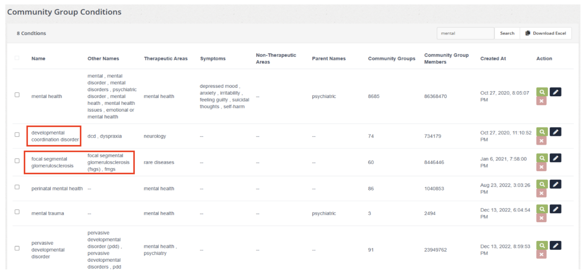
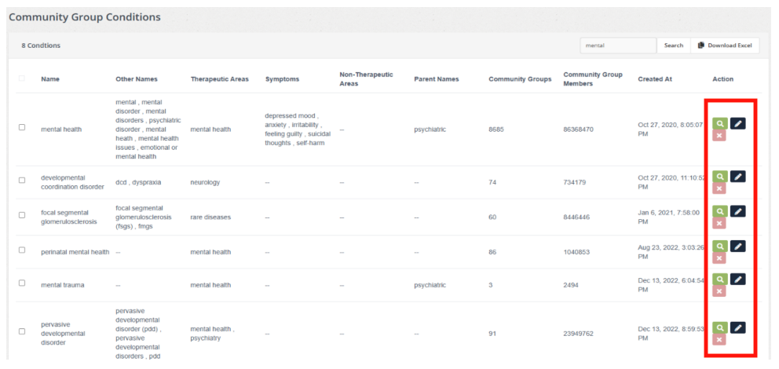

# TASK 2

Your second task is to write down possible bugs or inconsistencies which you can find.

Below is the screenshot of search functionality on health condition name.

- Find all the bugs
- Categorize them on different types of bugs.
- Identify which bugs are minor and major.

---

## BUG-001

**Title:** Irrelevant health conditions displayed in the search results

**Severity:** Major

**Priority:** High

**Bug category:** Data Bug - Search Accuracy

**Description:** Verify that the search functionality returns accurate and relevant Community Group Conditions records based on the entered search keyword. The system displays health conditions that appear unrelated to the searched term, potentially affecting the accuracy of search results and users' ability to locate relevant records.

**Preconditions:**
- User has access to the Community Group Conditions page.
- Community Group Conditions records are available in the system.

**Test Data:** data with the word “mental”

**Steps to replicate:**
1. Go to Community Group Conditions page
2. Input “mental” in the search bar then enter
3. Check the displayed search results

**Expected result:** Should display the correct data relevant to the searched word

**Actual result:**

The search results display the following health conditions, which appear unrelated to the search keyword:

- Developmental coordination disorder
- Focal segmental glomerulosclerosis

**Screenshot:**

---

## BUG-002

**Title:** Inconsistent spacing in action buttons

**Severity:** Minor

**Priority:** Low

**Bug category:** UI Bug

**Description:** Verify the spacing and alignment of action buttons within the Community Group Conditions table. The buttons appear to have inconsistent spacing, affecting the visual consistency and overall presentation of the interface.

**Preconditions:**
- User has access to the Community Group Conditions page.
- Community Group Conditions records are displayed in the table.

**Test Data:** Existing Community Group Conditions data

**Steps to replicate:**
1. Go to Community Group Conditions page
2. Input “mental” in the search bar then enter
3. Check the spacing and alignment of action buttons.
4. Repeat the inspection using different screen sizes and resolutions.
5. Observe the spacing and alignment remain consistent.

**Expected result:** Action buttons should maintain consistent spacing and alignment across supported screen sizes. They should remain properly positioned, visible, and accessible without overlapping or appearing uneven.

**Actual result:** The action buttons are not properly spaced. The "X" (delete) button appears directly below the Search icon instead of being aligned horizontally with the other action buttons, resulting in an inconsistent layout.

**Screenshot:**

---

## BUG-003

**Title:** Redundant search action button in the Action column

**Severity:** Minor

**Priority:** Low

**Bug category:** UI Bug

**Description:** The Community Group Conditions page already provides a search bar at the top of the page. However, an additional Search icon is displayed in the Action column for individual records. This may cause confusion regarding the purpose of the additional search action.

**Preconditions:**
- User has access to the Community Group Conditions page.
- Community Group Conditions records are displayed in the table.

**Test Data:** Existing Community Group Conditions data

**Steps to replicate:**
1. Go to Community Group Conditions page
2. Input “mental” in the search bar then enter
3. Check the search icon in the Action column

**Expected result:** The Action column should display only the intended record-specific actions. Any additional Search button should have a clearly defined purpose and should not duplicate the functionality of the main search bar.

**Actual result:** A Search icon is displayed in the Action column despite the presence of a search bar at the top of the page.

**Screenshot:**
